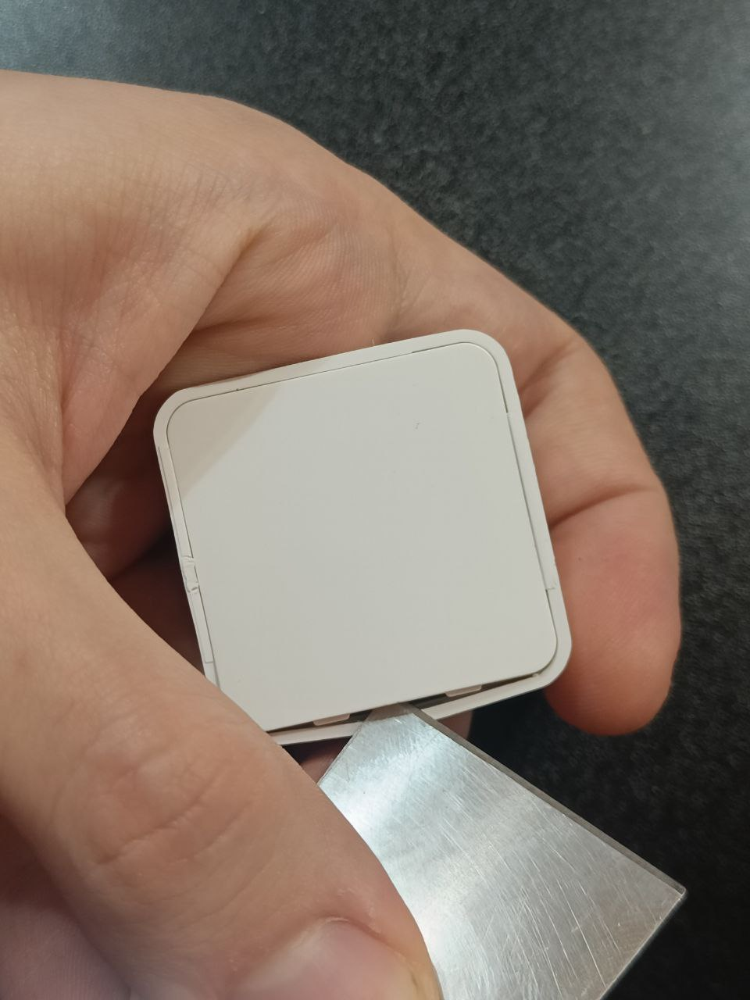
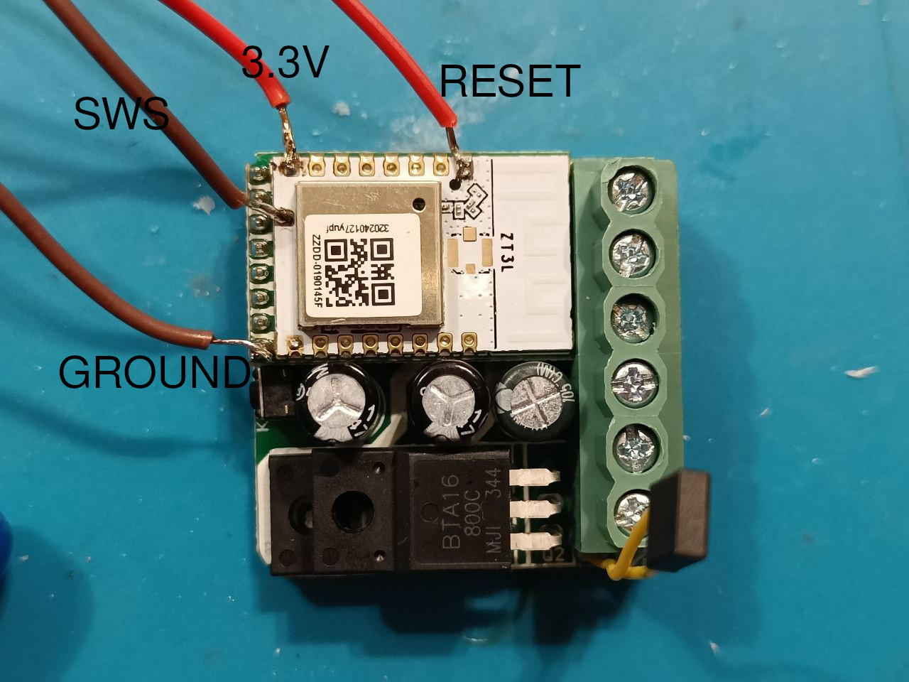
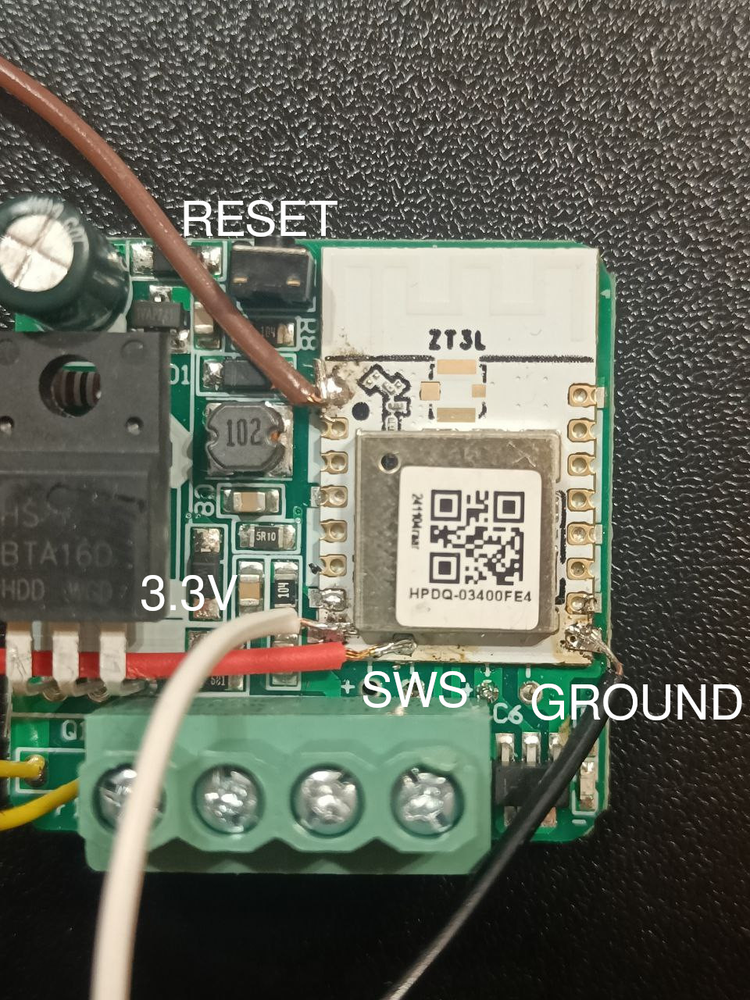

# How to Flash via Wire

### What You'll Need

- A UART programmer (preferably one with an exposed RTS pin). I used the FT232RL.
- A soldering iron
- Some spare jumper wires

### Step 1: Disassemble the Device

Unplug the device from the mains. **Never attempt to disassemble it while it is plugged in!**  

Start by removing the back cover. Use any flat object to pop it off.  Here is a picture for TS0012, other devices can be opened in a similar way:

  

Next, remove the board from the case by pushing on the screws; it should come out easily.

### Step 2: Solder the Wires

You’ll need to solder four wires as shown in the photo: 

  
TS0012

  
   
  

  
TS0011 (or any ZT3L module)

   Note that I desoldered capacitors for easier access to SWS pin. It is OK to flash a device without them, but you need to reinstall them if you plan to use the device. Alternatively, you can try to solder SWS pin without this manipulation.

    

The RESET wire is optional if your UART programmer lacks an RTS pin. It may work without it, but having it is preferable.  

Attach the wires to your UART as follows:  
- **3.3V** to **3.3V**  
- **Ground** to **Ground**  
- **SWS** to the **TX pin** of the programmer  
- **Reset** to the **RTS pin** of the programmer  

### Step 3: Flash the Firmware

Download the full firmware for your device from [bin/](https://github.com/romasku/tuya-zigbee-switch/raw/refs/heads/main/bin).  

Plug the UART into your PC, then open pvvx's [web flasher](https://pvvx.github.io/ATC_MiThermometer/USBCOMFlashTx.html).  

1. Select Baud **1500000** (for faster flashing), click "Open," and choose your UART port.  
2. Click "Choose file" and select the firmware you downloaded.  
3. Click "Erase All Flash" and wait until the process finishes.  
4. Click "Write to Flash" and wait until the process finishes.  

If done correctly, the onboard LED will start flashing automatically. You can try joining the device to a Zigbee network to verify that it connects properly. Once confirmed, disconnect everything, unsolder the wires, and reassemble the case.  

## Troubleshooting

If using the SWS is not working or you want to backup the existing firmware, try using [Suxsem's tool](https://github.com/Suxsem/Telink-Zigbee-serial-flash-tool). _Note, that this requires some extra wiring and the correct pinout (for my ZT3L: PA0 = RX - pin 12, PB1 = TX - pin 16)!_

C:\Telink-Zigbee-serial-flash-tool-main> python.exe .\Telink_Tools.py --port COM9 read_flash 0 0x100000 myfirmware.out
Telink_Tools.py v0.2 dev Suxsem
Open COM9 ... ... Success!
Connect Board ... ...Success!
Loader version: S0.2 - Chip version: 02 - Chip product: 5562 (825x ?) - Flash ID: c86014 - Flash size: 1024 KB

Reading to binary file: myfirmware.out
100% [>>>>>>>>>>>>>>>>>>>>>>>>>>>>>>>>>>>>>>>>>>>>>>>>>>]

